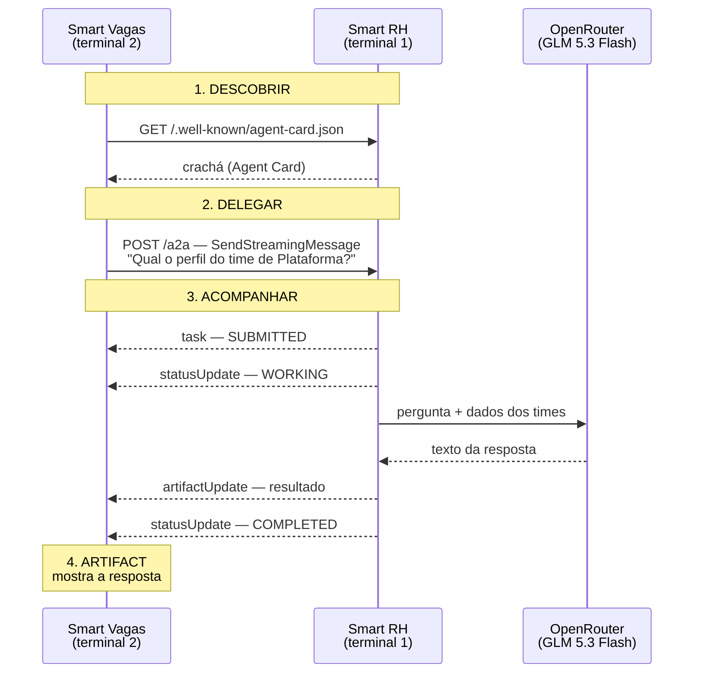

# Como funciona a POC A2A

Para rodar, veja o [README](README.md). Este documento explica **o que** acontece e **por quê**.

## A ideia em uma frase

Dois agentes de times diferentes conversam usando um protocolo padrão, o **A2A**. O **Agente Smart Vagas** precisa de uma informação que só o **Agente Smart RH** tem, então ele pede ao Smart RH em vez de acessar os dados diretamente.

É o exemplo do slide 2 da apresentação rodando de verdade.

## Os dois programas

| | **Smart RH** — [smart_rh.py](smart_rh.py) | **Smart Vagas** — [smart_vagas.py](smart_vagas.py) |
|---|---|---|
| Papel | Quem **sabe** a resposta (servidor) | Quem **pergunta** (cliente) |
| Onde roda | Terminal 1, fica esperando pedidos | Terminal 2, pede a sua pergunta e mostra a resposta |
| Tem LLM? | Sim: o GLM 5.3 Flash (`z-ai/glm-5.3-flash`, via OpenRouter) é o "cérebro" dele | Não: é um script que faz o papel de outro agente |
| Tem dados? | Sim: 3 times fictícios (Plataforma, Dados, Produto) | Não |
| Usa o SDK do A2A? | Sim, o SDK oficial `a2a-sdk` | Não: só HTTP + JSON |

## O fluxo completo



### Passo 1 — DESCOBRIR

O Smart Vagas acessa `http://localhost:9999/.well-known/agent-card.json` e recebe o **crachá** do Smart RH: quem ele é, o que sabe fazer e onde mandar pedidos.

```json
{
  "name": "Agente Smart RH",
  "description": "Responde sobre times, headcount e histórico de desligamentos.",
  "supportedInterfaces": [
    { "url": "http://localhost:9999/a2a", "protocolBinding": "JSONRPC", "protocolVersion": "1.0" }
  ],
  "capabilities": { "streaming": true },
  "skills": [
    { "id": "perfil-time", "name": "Perfil do time",
      "description": "Retorna headcount, senioridade e desligamentos recentes de um time." }
  ]
}
```

É o mesmo JSON do slide 3, só que real. Com ele, o Smart Vagas descobre sozinho para onde enviar a pergunta (`url`).

### Passo 2 — DELEGAR

Depois de descobrir o Smart RH, o Smart Vagas pede que **você digite a pergunta**. Ele coloca o que você digitou num JSON (método `SendStreamingMessage`) e envia com um `POST` para a `url` que veio no crachá:

```json
{
  "jsonrpc": "2.0",
  "id": 1,
  "method": "SendStreamingMessage",
  "params": {
    "message": {
      "messageId": "42ea35af-...",
      "role": "ROLE_USER",
      "parts": [{ "text": "Vou abrir uma vaga no time de Plataforma. Qual o perfil atual do time?" }]
    }
  }
}
```

A requisição também leva o header `A2A-Version: 1.0`. Sem ele, o servidor recusa o pedido, porque não sabe qual versão do protocolo o cliente está usando.

### Passo 3 — ACOMPANHAR

O Smart RH não responde de uma vez. Ele cria uma **Task** e mantém a conexão aberta, mandando avisos à medida que avança (*streaming*):

```
+ 0.0s  task            SUBMITTED   recebi o pedido
+ 0.0s  statusUpdate    WORKING     consultando dados do time...
+ 1.9s  artifactUpdate  perfil-time chegou o resultado
+ 1.9s  statusUpdate    COMPLETED   terminei
```

São os estados do slide 4. É durante o `WORKING` que o Smart RH consulta o LLM. Aqui tudo leva uns 2 segundos, mas o protocolo foi feito para tarefas que podem levar minutos ou horas. Por isso existe o acompanhamento, em vez de uma resposta única e direta.

### Passo 4 — ARTIFACT

O **Artifact** é o entregável final, o texto da resposta:

> O time de Plataforma tem 12 pessoas: 7 sêniores, 4 plenos e 1 júnior. Nos últimos 6 meses, houve 1 desligamento.

## Enquanto isso, dentro do Smart RH

O terminal 1 mostra o lado do servidor:

```
← mensagem recebida: "Vou abrir uma vaga no time de Plataforma. Qual o perfil atual do time?"
task fb10585d: SUBMITTED
task fb10585d: WORKING
→ chamando z-ai/glm-5.3-flash...
← z-ai/glm-5.3-flash respondeu em 2.3s
task fb10585d: COMPLETED
```

O Smart RH manda para o LLM (via OpenRouter) a pergunta e os dados dos times, com a instrução de responder usando **apenas** esses dados. Ele pode fazer contas e comparações (ex.: "qual time tem a maior rotatividade?"), e se os dados não respondem a pergunta (ex.: salário) ele diz isso. Depois embala o texto recebido como Artifact e marca a Task como concluída.

Depois da resposta, o Smart Vagas pede outra pergunta e repete os passos 2 a 4, sem repetir o passo 1: o crachá já foi lido.

## O ponto principal para a plateia

**O Smart Vagas não sabe qual LLM existe do outro lado**, nem como o Smart RH funciona por dentro. Ele só conhece o crachá e o formato das mensagens. O time do Smart RH poderia trocar de LLM, de linguagem ou de infraestrutura sem o Smart Vagas perceber.

Isso também vale no outro sentido: o Smart Vagas foi escrito **sem nenhuma biblioteca de A2A**, só HTTP e JSON, e mesmo assim conversa com um servidor feito com o SDK oficial. É o *"interoperável por design"* do slide 3.

## E se algo der errado?

Se o LLM não responder (sem internet, chave errada, limite do modelo gratuito ou demora maior que 20s), o Smart RH monta a resposta direto dos dados fictícios. **O fluxo A2A na tela do Smart Vagas continua igual**; só o log do Smart RH avisa que usou o modo offline. Com `--offline`, o servidor já sobe nesse modo.

## Onde cada coisa está no código

| O quê | Onde |
|---|---|
| O crachá (Agent Card) | [`montar_card`](smart_rh.py#L185) |
| O que o Smart RH faz ao receber a pergunta | [`SmartRHExecutor.execute`](smart_rh.py#L154) |
| A chamada ao LLM (OpenRouter) | [`perguntar_llm`](smart_rh.py#L85) |
| A resposta offline | [`resposta_offline`](smart_rh.py#L72) |
| Passo 1 do Smart Vagas | [`descobrir`](smart_vagas.py#L50) |
| Passo 2 do Smart Vagas | [`montar_requisicao`](smart_vagas.py#L62) |
| Passo 3 do Smart Vagas | [`acompanhar`](smart_vagas.py#L78) |
| Passos 2 a 4 para cada pergunta | [`conversar`](smart_vagas.py#L119) |

## O que é simplificado

- Os **dados dos times são inventados**.
- O **Smart Vagas não é um agente "inteligente"**. Na vida real, ele teria um LLM que decidiria sozinho chamar o Smart RH ao ler as skills do crachá. Aqui quem escolhe a pergunta é você.
- **Os dois rodam na mesma máquina**. Na vida real, cada um estaria no servidor de um time diferente, com autenticação (o `securitySchemes` do crachá, que a POC não usa).
