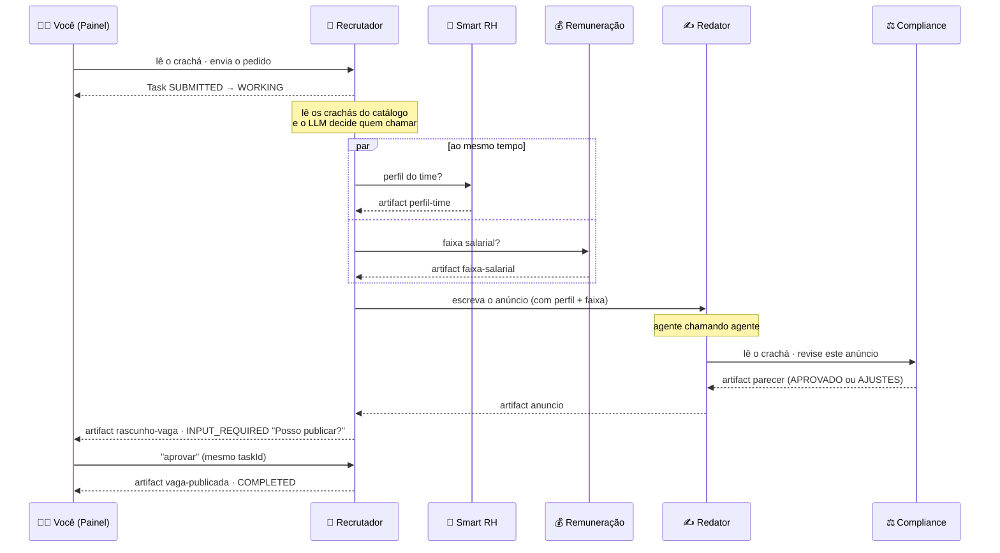

# Como funciona a POC 2

Para rodar, veja o [README](README.md). Este documento explica **o que** acontece e **por quê**.

## A ideia em uma frase

Um pedido de abertura de vaga é resolvido por **5 agentes de "times" diferentes** que só se conhecem pelos **crachás** (Agent Cards) e conversam pelo protocolo **A2A**, até uma **pessoa aprovar** o resultado.

## Os agentes

| Agente | Porta | Skill no crachá | O que faz | Chama | LLM |
|---|---|---|---|---|---|
| 🤖 Recrutador | 10001 | `abrir-vaga` | Orquestra: lê os crachás, decide quem chamar, pede aprovação | RH, Remuneração, Redator | Sim: decide quem chamar |
| 👥 Smart RH | 10002 | `perfil-time` | Perfil dos times (dados fictícios) | — | Sim: responde sobre os dados |
| 💰 Remuneração | 10003 | `faixa-salarial` | Faixa salarial por área e nível (tabela fictícia) | — | Sim: responde sobre a tabela |
| ✍️ Redator | 10004 | `escrever-vaga` | Escreve o anúncio e pede revisão ao Compliance | **Compliance** | Sim: escreve |
| ⚖️ Compliance | 10005 | `revisar-vaga` | Revisa linguagem inclusiva, discriminação e LGPD | — | Sim: revisa |

Além deles, o **Painel** (`http://localhost:8000`) é a página web e também o cliente A2A da pessoa recrutadora: é ele quem manda o pedido e a aprovação para o Recrutador.

Tudo sobe com `python rodar.py`, num processo só, mas **cada agente tem sua porta e seu crachá**, e toda conversa entre eles é **HTTP A2A de verdade**.

## O fluxo completo

## Como o Recrutador decide

O Recrutador **não sabe de antemão** quem chamar. Ele:

1. Lê os crachás dos agentes do catálogo (RH, Remuneração, Redator).
2. Transforma **cada skill de cada crachá numa ferramenta** do LLM. O nome da ferramenta é o id da skill, e a descrição é a descrição da skill ([`ferramentas`](agentes/recrutador.py#L46)).
3. Pergunta ao LLM o que fazer. Cada ferramenta que o LLM escolhe vira **uma mensagem A2A** ao agente dono da skill ([`chamar_ferramenta`](agentes/recrutador.py#L67)).
4. Repete até o LLM responder "PRONTO", em no máximo **`MAX_PASSOS = 6`** voltas. O resultado é o anúncio que o Redator entregou: o LLM não precisa reescrevê-lo ([`orquestrar`](agentes/recrutador.py#L83)).

No ensaio com o `z-ai/glm-5.3-flash` (via OpenRouter), o Recrutador:
- **no 1º passo** (~2s), chamou `perfil-time` e `faixa-salarial` **ao mesmo tempo**, escrevendo a mensagem de cada um (ex.: *"Faixa salarial mensal (CLT) de Analista de Dados Sênior na área de Dados"*);
- **no 2º passo**, com as duas respostas em mãos, chamou `escrever-vaga`, passando o perfil do time e a faixa na mensagem;
- **no 3º passo**, com o anúncio aprovado pelo Compliance, respondeu "PRONTO".

A vaga chegou à aprovação em ~18s (a maior parte é o Redator escrevendo o anúncio).

Ninguém programou essa ordem: ela saiu da leitura das descrições das skills. É o slide 3 na prática, *"o agente escolhe com quem falar lendo as skills do card"*. Descrição ruim = agente ignorado.

## Agente chamando agente

O Recrutador **não conhece** o Compliance, porque ele não está no catálogo dele. Quem conhece é o Redator: antes de entregar o anúncio, o Redator lê o crachá do Compliance e pede a revisão ([`redator.responder`](agentes/redator.py#L38)).

- Se o Compliance responde **APROVADO**, o anúncio segue com o parecer anexado.
- Se responde **AJUSTES: …**, o Redator reescreve uma vez aplicando os ajustes.

Para o Recrutador, isso é invisível: ele só recebe o anúncio pronto. É assim que A2A funciona entre times: cada um delega como quiser por dentro.

## A pausa para aprovação (`INPUT_REQUIRED`)

Com o anúncio pronto, o Recrutador **não termina a Task**. Ele publica o artifact `rascunho-vaga` e muda o estado para `INPUT_REQUIRED` com a pergunta "A vaga está pronta. Posso publicar?". Nesse momento a conexão fecha, mas a Task continua existindo ([`RecrutadorExecutor.execute`](agentes/recrutador.py#L140)).

O Painel mostra o cartão de aprovação. A sua resposta vai numa **nova mensagem com o mesmo `taskId`**, e o Recrutador retoma a mesma Task:
- **Aprovar** → artifact `vaga-publicada` e `COMPLETED` ([`publicar`](agentes/recrutador.py#L160)).
- **Pedir ajuste** (qualquer outro texto) → o Recrutador manda o ajuste ao Redator. O Redator passa pelo Compliance de novo, e o Recrutador volta a pedir aprovação ([`ajustar`](agentes/recrutador.py#L166)).

É o human-in-the-loop dentro do protocolo: slides 4 e 12.

## O que a tela mostra

Cada agente usa o mesmo cliente A2A ([`a2a_cliente.enviar`](comum/a2a_cliente.py#L81)). Tudo o que esse cliente envia e recebe vira um **evento**, e o Painel repassa esses eventos ao navegador em tempo real.

| Evento | No mapa | Na conversa |
|---|---|---|
| `descoberta` | ponto cinza vai até o agente | "🔎 X leu o crachá de Y" + skills (clique: crachá) |
| `mensagem` | linha acende, ponto na cor de quem fala | balão "X → Y" (clique: JSON-RPC enviado) |
| `estado` | selo do agente (`WORKING`, `COMPLETED`…) | linha com o estado e a mensagem de status |
| `artifact` | ponto verde volta para quem pediu | balão verde com o resultado |
| `pensando` | agente pulsa, texto embaixo | "💭 X: decidindo quem chamar…" |
| `aprovacao` | Recrutador em `INPUT_REQUIRED` | cartão com Aprovar / Pedir ajuste |

- **Ritmo de apresentação** (ligado por padrão): os eventos aparecem com um intervalo mínimo, porque sem isso tudo passaria rápido demais para a plateia acompanhar.
- **Revisão:** `http://localhost:8000/?replay=1` mostra a última conversa inteira, sem animação.

Uma conversa completa gera ~33 eventos. Em modo offline, os agentes terminam em ~2s, e a tela leva ~20s para exibir tudo no ritmo de apresentação.

## E se algo der errado?

- **Sem chave, sem internet ou LLM falhando:** cada agente responde com um texto montado a partir dos dados fictícios, e o Recrutador segue um **roteiro fixo** (RH e Remuneração ao mesmo tempo, depois o Redator). O fluxo na tela é o mesmo; só o selo no topo muda para "modo offline".
- **Timeouts:** 20s por chamada ao LLM (depois disso, resposta offline) e 120s de leitura por conversa A2A.
- **Um agente falha:** a Task dele vai para `FAILED`, e o Recrutador segue com o que tiver.
- **Loop do LLM:** o limite de 6 passos corta o loop e usa o último anúncio do Redator.
- **Chave nunca aparece** em log nem na tela: só o motivo curto (ex.: `HTTP 401 chave inválida`).

## Onde cada coisa está no código

| O quê | Onde |
|---|---|
| Quem são os agentes e as portas | [`comum/catalogo.py`](comum/catalogo.py) |
| Crachá + servidor A2A de cada agente (SDK oficial) | [`criar_card`](comum/servidor.py#L27), [`AgenteSimples`](comum/servidor.py#L61) |
| Cliente A2A (HTTP + JSON, sem SDK) | [`descobrir`](comum/a2a_cliente.py#L45), [`enviar`](comum/a2a_cliente.py#L81) |
| Chamada ao LLM e fallback | [`llm.responder`](comum/llm.py#L53), [`llm.conversar`](comum/llm.py#L27) |
| Decisão do Recrutador | [`ferramentas`](agentes/recrutador.py#L46), [`orquestrar`](agentes/recrutador.py#L83), [`roteiro_fixo`](agentes/recrutador.py#L108) |
| Aprovação humana | [`RecrutadorExecutor`](agentes/recrutador.py#L134) |
| Redator → Compliance | [`redator.responder`](agentes/redator.py#L38) |
| Painel (servidor) | [`painel/app.py`](painel/app.py) |
| Painel (tela) | [`painel/index.html`](painel/index.html) |
| Subir tudo | [`rodar.py`](rodar.py) |

## Ligação com os slides

| Slide | Onde aparece na demo |
|---|---|
| 2 — O que é o A2A | Smart Vagas virou o Recrutador; o Smart RH é o mesmo da POC 1, agora com mais colegas |
| 3 — Descobrir, delegar, acompanhar | Linhas "leu o crachá", balões `SendStreamingMessage`, estados ao vivo; o LLM escolhe pelas skills |
| 4 — A vida de uma tarefa | Selos `SUBMITTED` → `WORKING` → `INPUT_REQUIRED` → `COMPLETED` no mapa |
| 5 — MCP vs A2A | Cada agente poderia usar MCP por dentro; entre eles, só A2A |
| 6 — Pirâmide do erro | 5 agentes e 6+ chamadas de LLM numa cadeia: por isso o modo offline, os timeouts e o limite de passos |
| 12 — Human-in-the-loop | Cartão de aprovação: nada é publicado sem o "sim" |
| 13 — Custo e guardrails | `MAX_PASSOS = 6` no Recrutador |
